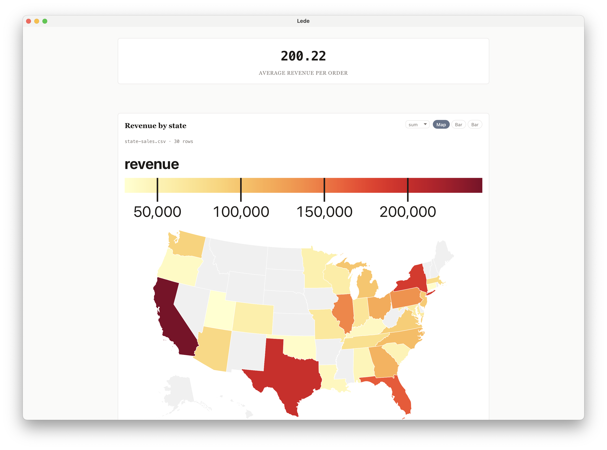
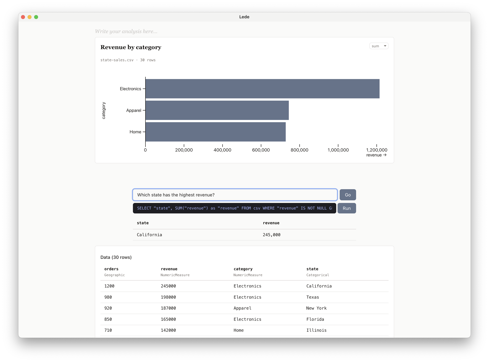
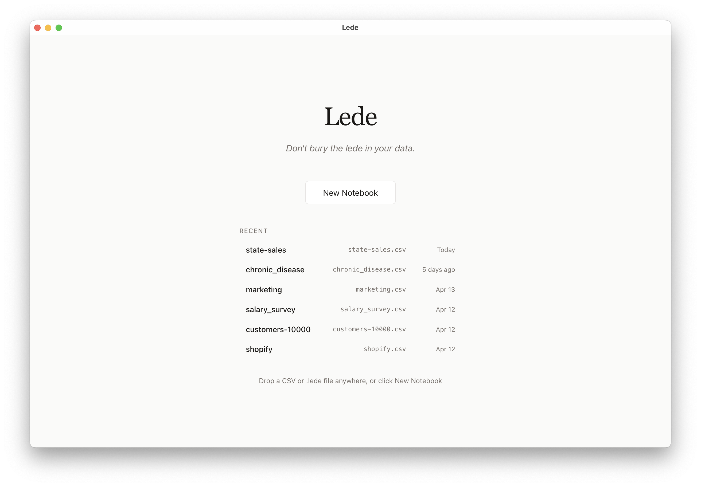

# Lede

Persistent local desktop workspace for data curiosity.
**Don't bury the lede in your data.**



> **Status: experimental.** Single-developer project, macOS only. Expect rough edges.

Lede is a desktop app for non-technical people with CSVs who want answers, not infrastructure. Drop a CSV, get instant charts, write notes alongside your data, and optionally enable local AI insights — all without sending your data anywhere.

## Features

- **Instant charts** — column classification and view suggestions in under a second
- **Local AI insights** — optional on-device LLM (Gemma 3 4B) suggests views and computes insights
- **Choropleth maps** — geographic columns automatically get map visualizations
- **Notebook format** — interleave prose and charts in a single document, save as `.lede` files
- **Full-dataset queries** — DuckDB-WASM aggregates over all rows, not just a sample
- **No cloud, no accounts** — everything runs locally on your Mac

## Screenshots

**Natural-language query bar** — ask a question, get a chart and the SQL behind it.



**Home screen** — drop a CSV or pick one from recents.



## Requirements

- macOS 11+ (Big Sur or later)
- Apple Silicon (M1/M2/M3/M4) or Intel via Rosetta 2
- 8 GB RAM minimum
- ~2.5 GB disk space for the AI model (downloaded on first use, optional)

## Development

### Prerequisites

- [Rust](https://rustup.rs/) (stable)
- [Node.js](https://nodejs.org/) 18+
- [Tauri CLI](https://tauri.app/start/): `cargo install tauri-cli`

### Setup

```bash
git clone https://github.com/vraman/lede.git
cd lede
npm install
```

### Run (development)

```bash
cargo tauri dev
```

### Run tests

```bash
# Rust tests
cd src-tauri && cargo test

# Frontend tests
npx vitest run

# TypeScript type checking
npx tsc --noEmit
```

### Build (release)

```bash
npm run tauri build
```

Produces:
- `src-tauri/target/release/bundle/macos/lede.app` (~30 MB)
- `src-tauri/target/release/bundle/dmg/lede_0.1.0_aarch64.dmg` (~19 MB)

## Architecture

**Rust owns the data. Frontend owns the pixels.**

- **Tauri** — desktop shell, IPC between Rust and React
- **Rust** — CSV parsing, column classification, view suggestions, AI inference (llama.cpp)
- **React + TypeScript** — UI rendering, Tiptap editor, Observable Plot charts
- **DuckDB-WASM** — full-dataset SQL aggregation in the browser
- **Gemma 3 4B** — local LLM for suggesting views and insights (optional, downloads on first use)

## Unsigned App Warning

The app is not code-signed. On first launch, macOS may block it. To open:

1. Right-click the app in Finder
2. Select "Open"
3. Click "Open" in the dialog

This is only needed once.

## License

MIT. See [LICENSE](LICENSE).

### Model license

The optional AI features use [Google's Gemma 3 4B](https://ai.google.dev/gemma) model, which is distributed under the [Gemma Terms of Use](https://ai.google.dev/gemma/terms). Enabling AI features and downloading the model implies agreement with those terms. Lede does not redistribute the model — it's fetched from Google's servers on first use.
